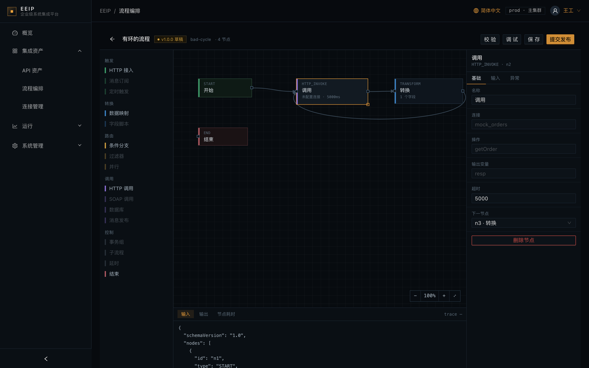
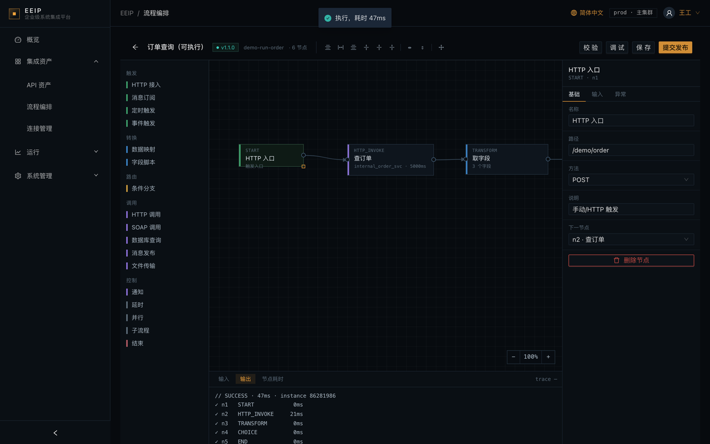
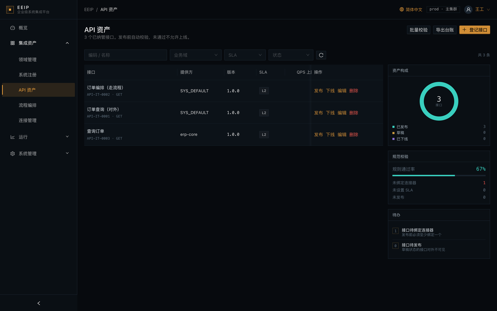
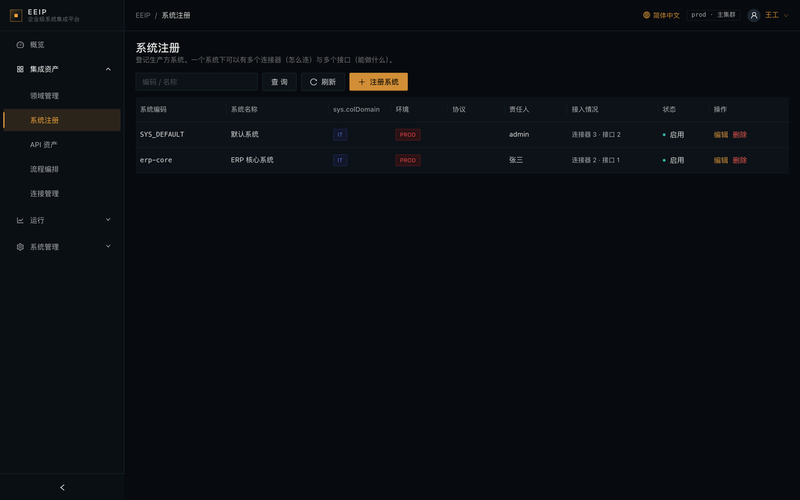
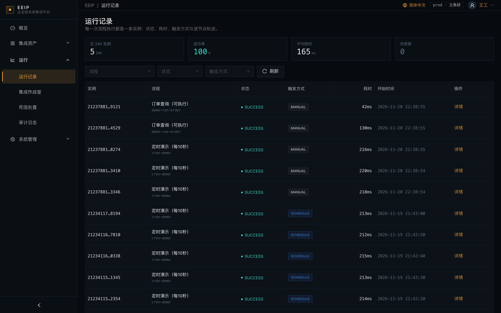
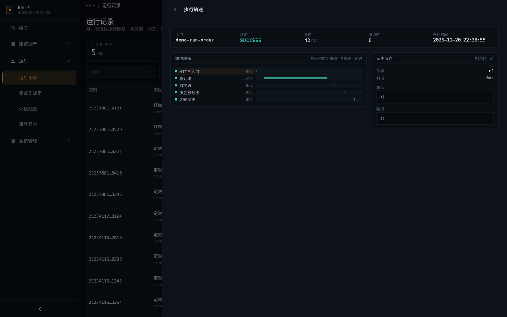
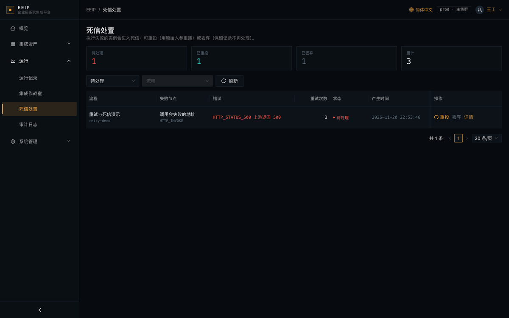
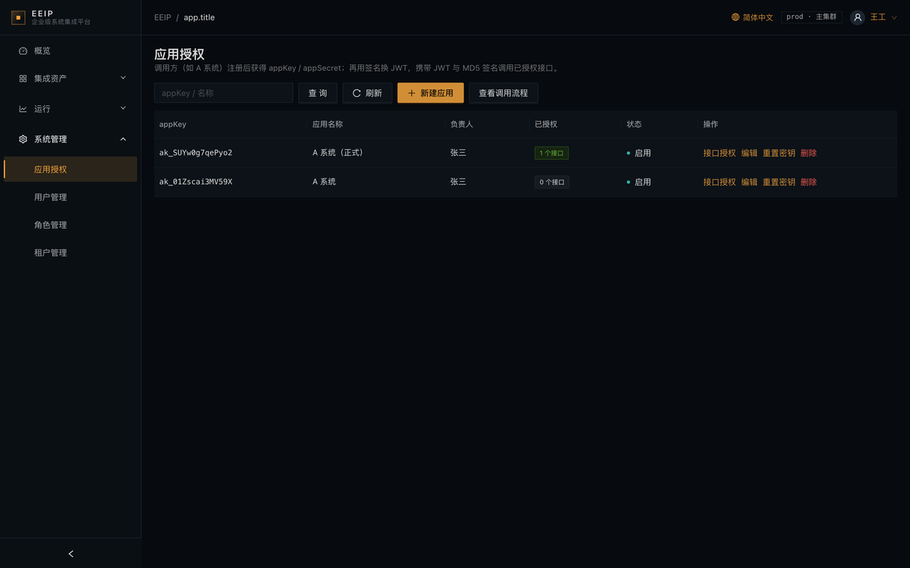
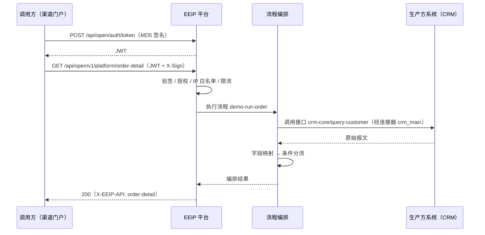

<div align="center">

# EEIP · 企业级系统集成平台

**把散落在各系统之间的直连，收敛为一条可治理、可追溯的集成底座**

[](https://github.com/Miccke/eeip/actions/workflows/ci.yml)
[](CHANGELOG.md)
[](#技术栈)
[](#技术栈)
[](#技术栈)
[](#国际化)
[](#许可)

</div>

---

## 这是什么

EEIP 是一个面向多系统、多协议环境的**统一集成底座**：把内部系统的接口登记进来，通过流程编排做协议转换与字段映射，再以统一的方式对内对外提供。

当前进度：**主干链路已闭环** —— 生产方系统注册、接口台账与版本、可视化编排、执行引擎、三方授权与开放网关都已跑通（`v1.3.0`）。

> 这是一个**企业内部项目**，代码托管在公开仓库主要用于审阅与演示。
> 每一步都有可运行的服务、可验证的截图与可复现的操作路径，见 [CHANGELOG](CHANGELOG.md)。

## 界面

**流程编排器** —— 调色板建节点、端口连线、属性面板三级选择（系统 → 接口 → 连接器）



**调试即真跑** —— 点「调试」执行一条实例，逐节点轨迹回显



| **API 资产**（接口台账 + 资产构成 + 规范校验） | **系统注册**（生产方系统，含领域与环境） |
| --- | --- |
|  |  |

**运行记录** —— 实例列表与调用瀑布图



| **执行轨迹**（瀑布图 + 节点输入输出） | **死信处置**（重投 / 丢弃） |
| --- | --- |
|  |  |

**应用授权** —— appKey/appSecret + 接口授权



## 能力

### 领域模型：系统 → 连接器 → 接口 → 对外发布

| 实体 | 回答的问题 |
| --- | --- |
| **系统**（`t_system`） | 接入的是谁：编码、名称、**环境**（DEV/TEST/PROD）、**业务领域** |
| **连接器**（`t_connection`） | 怎么连：协议（HTTP/SOAP/JDBC/MQ/FILE）、地址、认证、超时 |
| **接口**（`t_api` + `t_api_version`） | 能做什么：方法、上游路径、SLA、**契约版本** |
| **对外发布**（`t_api_expose`） | 给谁用：自动生成的对外地址、鉴权方式、限流 |
| **应用**（`t_app_client`） | 调用方是谁：appKey / appSecret、IP 白名单 |

- 一个系统可以有**多个连接器**（主备/多环境）与**多种协议的接口**
- 一个接口版本可绑定**多个连接器**（`MAIN` / `BACKUP`）
- 接口与流程**双向关联**：接口可由流程实现，流程也可调用接口

### 流程编排与执行

- 可视化编排器：调色板建节点、端口连线（拖拽或点选）、框选多选、对齐分布、快捷键
- **节点规格驱动**：节点定义收敛为 `node-packages/*/node.json`（Manifest），
  调色板/画布/属性面板/校验全部由它驱动 —— 新增节点只加一个目录，不改框架代码
- 发布前强校验：结构、引用完整性、可达性、**环检测**、配置 Schema
- 报错精确到节点：`FLOW_CYCLE 存在环：n2 → n3 → n2`
- **执行引擎 v0**：串行执行 START / HTTP_INVOKE / TRANSFORM / CHOICE / DELAY / NOTIFY / END
- 变量作用域 `trigger` / `outputVar` / `nodes.<id>` / `sys.*`；每节点输入输出与耗时落库
- 编排器「调试」直接跑实例，轨迹回显在调试台
- **调度器**：发布版的定时节点自动生成触发计划，按 Cron 自动执行并落实例；
  支持暂停/启用，暂停后不再触发
- **运行记录**：实例列表（按流程/状态/触发方式过滤）+ 调用瀑布图 + 节点输入输出
- **重试与死信**：节点级重试（`retry.maxAttempts`）；失败实例落死信，可原参重投或丢弃

### 接口开放与三方授权

```
调用方 A ──签名换 JWT──▶ 平台 ──验签/鉴权/限流──▶ 流程编排 ──▶ 生产方系统 B
```

- 调用方用 `appKey/appSecret` 换 JWT：`MD5(appKey+timestamp+nonce+secret)`
- 调接口时携带 JWT + `X-Timestamp` / `X-Nonce` / `X-Sign`，签名含方法与方法路径
- 校验链：令牌 → 时间窗（±5 分钟）→ 签名 → nonce 防重放 → 授权关系 → IP 白名单 → QPS 限流
- 两种对外方式：**透传**（PROXY，直接转发）与**走流程**（FLOW，编排后返回）

### 权限与治理

- **五层鉴权**：菜单 / 路由 / 接口（`@PreAuthorize`）/ 按钮（`v-hasPerm`）/ 数据（`@DataScope`）
- **多租户**：登录按租户编码识别，SQL 自动带 `tenant_id`；支持一键开通租户
- **操作审计**：`@AuditLog` + AOP，参数自动脱敏，异步落库，只追加不可改
- **国际化**：简中 / 繁中 / 英文，前端一键切换，后端按 `Accept-Language` 返回文案与菜单名

## 端到端链路

调用方 → 平台 → 生产方系统 → API → 流程编排：



**接口与流程的双向关系**

| 方向 | 配置 | 含义 |
| --- | --- | --- |
| 接口 → 流程 | `t_api.target_type=FLOW` + `flow_code` | 这个对外接口由流程实现（编排/转换后返回） |
| 流程 → 接口 | 节点 `config.apiCode="systemCode/apiCode"` | 流程里调用某个已登记接口，自动解析契约与主连接器 |

## 技术栈

| 层 | 选型 |
| --- | --- |
| 前端 | Vue 3.5 · TypeScript · Vite 6 · Ant Design Vue 4 · Pinia · vue-i18n |
| 后端 | Spring Boot 3.3 · Spring Security · MyBatis-Plus 3.5 · Flyway |
| 数据 | PostgreSQL 16 · Redis 7（Docker） |
| 文档 | SpringDoc OpenAPI 3（字段级 `@Schema`） |

**架构选择**：模块化单体。多租户与数据权限在 SQL 拦截器层统一处理，业务代码零感知；
节点体系用 Manifest 驱动，扩展不改框架代码。

## 快速开始

```bash
# ① 中间件（PostgreSQL / Redis / Adminer）
./scripts/start-middleware.sh

# ② 后端 → http://localhost:8080
./scripts/start-backend.sh

# ③ 前端 → http://localhost:5173（另开终端）
./scripts/start-frontend.sh
```

首次启动自动执行 Flyway 迁移与种子数据，**无需手工建库建表**。

| 服务 | 地址 |
| --- | --- |
| 前端控制台 | http://localhost:5173 |
| Swagger UI | http://localhost:8080/swagger-ui.html |
| 健康检查 | http://localhost:8080/actuator/health |
| Adminer（DB） | http://localhost:8088 |

> 本机若无 JDK 17：`scripts/env.sh` 会自动使用仓库内 `.tools/` 下的便携 JDK 17 + Maven（不污染系统环境）。

## 演示账号

密码统一 `Admin@123`，登录时需填**租户编码**。

| 租户 | 账号 | 角色 | 数据范围 | 用户列表可见 |
| --- | --- | --- | --- | :-: |
| `GROUP` | `admin` | 超级管理员 | ALL | 9 人 |
| `GROUP` | `mgr01` | 部门管理员 | PROJECT（同部门） | 6 人 |
| `GROUP` | `mgr02` | 个人管理员 | SELF | 1 人 |
| `GROUP` | `dev01` | 集成开发 | PROJECT | 403 |
| `SUPPLIER_A` | `admin` | 租户管理员 | 按授权 | 2 人 |

## 工程结构

```
EEIP/
├── backend/              Spring Boot（common：响应/异常/安全/审计/数据权限/租户/国际化）
│   └── src/main/
│       ├── java/com/eeip/{common, module}
│       └── resources/{db/migration, i18n, node-packages}
├── frontend/             Vue 3 + Vite（api / stores / router / layouts / views / locales）
│   └── src/node-packages 节点规格（Manifest，唯一来源）
├── deploy/               docker-compose（PG / Redis / Adminer）
├── scripts/              env.sh · start-*.sh · sync-node-packages.mjs
├── assets/screens/       README 界面截图
├── .github/workflows/    CI（后端构建 / 前端构建 / 三语词条 / 节点规格一致性）
└── docs/                 ⚠️ 本地文档，已 gitignore，不随仓库分发
    ├── requirements/     需求分析 15 份
    ├── design/           详细设计 16 份（含编排器设计、业务对象模型）
    ├── prototype/        界面原型
    ├── screenshots/      验收截图
    └── 每日总结/          按天记录（YYYY-MM-DD.md）
```

## 文档

| 文档 | 位置 | 是否进仓库 |
| --- | --- | :-: |
| 版本演进与验收证据 | [CHANGELOG.md](CHANGELOG.md) | ✅ |
| 开发手册（账号矩阵 / 鉴权 / 迭代计划 / 踩坑） | `docs/DEVELOPMENT.md` | ❌ |
| 需求分析（15 份） | `docs/requirements/` | ❌ |
| 详细设计（16 份，含编排器与领域模型） | `docs/design/` | ❌ |
| 界面原型 | `docs/prototype/` | ❌ |
| 每日总结 | `docs/每日总结/` | ❌ |

> 需求与设计文档属于**内部资料**，仅保留在本地 `docs/` 目录（已加入 `.gitignore`）。

## 路线图

| 版本 | 主题 | 状态 |
| --- | --- | --- |
| v0.5 | 权限与治理地基：RBAC / 多租户 / 审计 / 数据范围 / 连接器 / 三语国际化 | ✅ |
| v0.6 | 流程 DSL 与校验：版本发布、环检测、可视化编排器、本地 Mock | ✅ |
| v0.7 | 节点 Manifest + 注册中心，配置 Schema 驱动校验 | ✅ |
| v0.8 | 接口开放（API 资产）：登记、鉴权、网关转发；节点扩到 17 种 | ✅ |
| v0.9 | 三方授权：应用注册、JWT + MD5 签名、接口授权 | ✅ |
| v1.0 | 执行引擎 v0：串行执行、变量作用域、错误策略、实例落库 | ✅ |
| v1.1 | 领域模型重构：系统 / 连接器 / 接口 / 对外发布分层 | ✅ |
| v1.2 | 领域体系、接口多协议、接口关联流程 | ✅ |
| v1.3 | 网关限流与 IP 白名单、编排器三级联动 | ✅ |
| v1.4 | **调度器**：`t_flow_trigger` + Cron 扫描 + 定时执行流程 | ✅ |
| v1.5 | **实例监控**：运行记录、指标卡、调用瀑布图、节点输入输出 | ✅ |
| v1.6 | **重试与死信**：节点重试、失败落死信、重投与丢弃 | ✅ |
| v1.7 | 映射编辑器、调用计量 | 计划 |

## 贡献与约定

- 代码须有**中文注释**：类与公开方法写 Javadoc，复杂逻辑解释"为什么"
- 接口须有**字段级 Swagger 注释**：每个 DTO/VO 字段都要 `@Schema(description, example)`
- 提交遵循 Conventional Commits（`feat` / `fix` / `docs` / `refactor` / `chore`）
- 数据库变更只新增 `V{n}__xxx.sql`，不修改已执行的迁移
- 节点规格只改 `frontend/src/node-packages`，并运行 `pnpm sync:nodes` 同步给后端

## 赞赏支持

如果这个项目对你有帮助，可以请我喝杯咖啡 ☕

<p align="center">
  
</p>

> 赞赏纯属自愿，**与代码授权无关**，也不构成任何服务承诺；不打赏同样可以使用全部功能。

## 许可

**本项目为企业内部项目，保留所有权利（Proprietary）。**

- 仓库对外公开仅为审阅与演示，**不代表开源**，未附带任何开源许可
- 未经作者书面许可，不得复制、分发、商用或用于衍生作品
- 第三方依赖遵循各自 LICENSE（清单见 `backend/pom.xml` 与 `frontend/package.json`）
